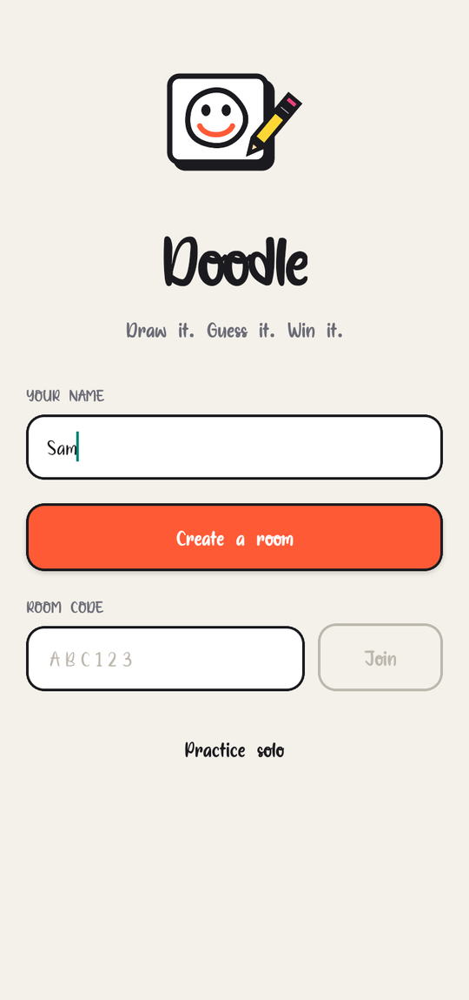
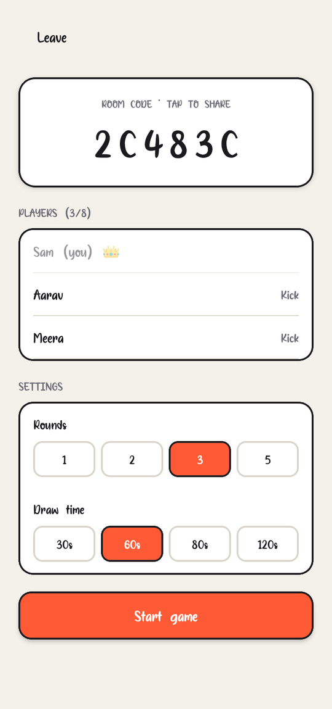
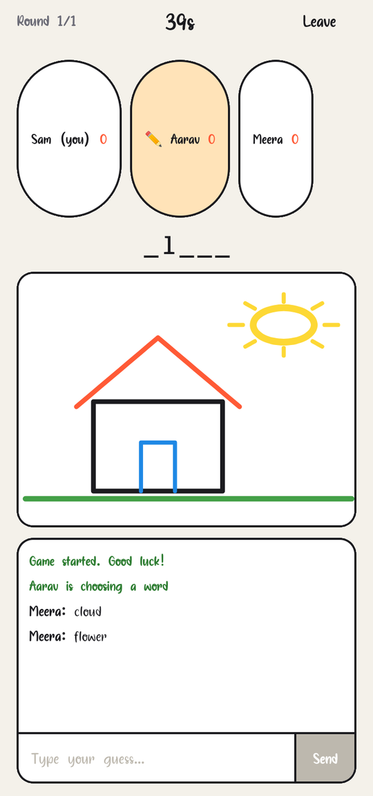

<p align="center">
  
</p>

<h1 align="center">Doodle</h1>

<p align="center">
  A real-time multiplayer drawing and guessing game.<br />
  One player draws, everyone else races to guess the word.
</p>

<p align="center">
  
  
  
</p>

## Features

- **Rooms:** create a room and share its 6-letter code. The host picks the number of rounds and the draw time, and can remove players.
- **Live drawing:** strokes stream to every player as they are drawn. The drawer has brush, eraser, undo, clear, sizes and colours.
- **Guessing:** players guess in chat. Near misses get a "close" hint, and letters are revealed as time runs out.
- **Scoring:** faster guesses earn more points, the drawer scores for every correct guess, and a leaderboard is shown at the end.
- **Reliability:** the server is authoritative and validates every event. Reconnects and players leaving mid-turn are handled.
- **Solo mode:** a practice sketchpad that works offline.

## Tech stack

| Layer    | Technology                                                                  |
| -------- | --------------------------------------------------------------------------- |
| Mobile   | Expo, React Native, React Native Skia, Gesture Handler, Reanimated, Zustand |
| Realtime | Node.js, Socket.IO, Redis (optional; rooms can be held in memory)           |
| API      | Fastify, Drizzle ORM, PostgreSQL                                            |
| Shared   | TypeScript and Zod schemas for every socket event and API payload           |
| Tooling  | pnpm workspaces, Turborepo, Vitest, ESLint, Prettier, GitHub Actions        |

## Project structure

```
apps/
  mobile/        Expo app (screens, canvas, game store)
  game-server/   Socket.IO game server
  api/           REST API
packages/
  shared/        Socket and API contract (Zod)
  db/            Database schema and migrations
  config/        Shared TypeScript config
```

## Getting started

Requirements: Node 22.12+, pnpm 10 (`corepack enable`), and for the app, Android Studio with JDK 17.

```sh
pnpm install
pnpm --filter @doodle/game-server dev:memory   # game server on :4001, no database needed
pnpm --filter @doodle/mobile android           # build and run the app on a device or emulator
```

Development builds connect to the game server on the machine running Metro, so keep your phone on the same Wi-Fi network as your computer. Release builds connect to the hosted server.

<details>
<summary>Full setup with Postgres and Redis</summary>

```sh
cp .env.example .env
docker compose up -d
pnpm --filter @doodle/db db:migrate
pnpm build
pnpm --filter @doodle/api dev            # http://localhost:4000/health
pnpm --filter @doodle/game-server dev    # http://localhost:4001/health
```

</details>

<details>
<summary>Android setup on Windows</summary>

1. Install Android Studio with Android SDK Platform 35 and Build-Tools 36.0.0, and JDK 17.
2. Set `ANDROID_HOME` to `%LOCALAPPDATA%\Android\Sdk` and add its `platform-tools` folder to `Path`.
3. Enable long paths (`LongPathsEnabled` in the registry and `git config --global core.longpaths true`), and clone into a path without spaces, such as `C:\dev\doodle`.
4. Turn on USB debugging on your phone, then run `pnpm check:android`.

</details>

## Scripts

| Command          | Description              |
| ---------------- | ------------------------ |
| `pnpm test`      | Run all test suites      |
| `pnpm lint`      | Lint every package       |
| `pnpm typecheck` | Type-check every package |
| `pnpm format`    | Format with Prettier     |

The game server tests include a complete game played over real sockets, from creating a room to the final leaderboard.

## Releases and deployment

- **APK:** the [Release APK](.github/workflows/release-apk.yml) workflow builds a signed APK for 32-bit and 64-bit ARM phones. Run it from the Actions tab, or push a `v*` tag to publish it as a GitHub Release.
- **Game server:** a [`Dockerfile`](Dockerfile) and a Render blueprint ([`render.yaml`](render.yaml)) are included. On Render, choose **New → Blueprint** and select this repository.

## Architecture

- **Shared contract:** `packages/shared` defines every socket event with a Zod schema. Client and server types are derived from it, and the server validates every payload before handling it.
- **Game loop:** each turn moves through `choosing → drawing → turn_end` on server timers. Guess matching, hints and scoring are pure, unit-tested functions.
- **Concurrency:** room updates take a per-room lock, so players can't overfill a room. Strokes for the current turn are kept in memory, so drawing never waits on the room lock.
- **Canvas:** strokes are built on the UI thread with gesture worklets and Skia, then normalised to 0–1 coordinates so they look the same on every screen size.
